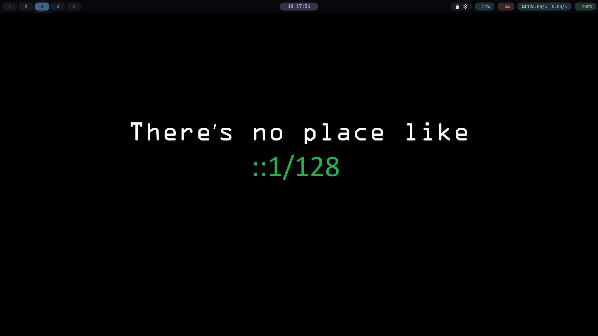

# My Arch Linux Dotfiles

Personal configuration files for Arch Linux with Hyprland - **minimal, modern, and beautiful**.



## 🎨 Setup Overview

- **WM**: Hyprland with smooth animations
- **Bar**: Waybar with dark glass theme
- **Terminal**: Ghostty with transparency
- **Launcher**: wofi
- **File Manager**: Thunar
- **Theme**: Catppuccin Mocha
- **Font**: JetBrainsMono Nerd Font
- **Wallpapers**: Dynamic switching with swww

## ✨ Features

- 🌑 **Dark glass aesthetic** - Semi-transparent modules with blur effects
- 🎨 **Dynamic wallpapers** - Smooth transitions with keyboard shortcuts
- 💎 **Modern pill-shaped modules** - Color-coded waybar modules
- 🔄 **Persistent wallpapers** - Automatically restore on login
- 📊 **System monitoring** - RAM, disk, network stats with real-time updates
- ⌨️ **Greek/English keyboard** - Easy switching with Alt+Shift
- 🎭 **Catppuccin Mocha** - Consistent theming across all apps

## 📦 Installation

### 1. Clone this repository

```bash
git clone https://github.com/adrew25/Arch-linux-Hyprland-simple-Ricing.git ~/dotfiles
cd ~/dotfiles
```

### 2. Install required packages

```bash
# Core packages
sudo pacman -S hyprland waybar ghostty wofi wlogout swww \
               wireplumber pamixer networkmanager nm-connection-editor \
               ttf-jetbrains-mono-nerd pavucontrol thunar \
               hyprlock polkit-gnome

# AUR packages (if using yay)
yay -S swww
```

### 3. Install dotfiles

```bash
# Backup existing configs (recommended)
mkdir -p ~/.config-backup-$(date +%Y%m%d)
cp -r ~/.config/{hypr,waybar,ghostty} ~/.config-backup-$(date +%Y%m%d)/ 2>/dev/null || true

# Install configs
cp hypr/hyprland.conf ~/.config/hypr/
cp waybar/config ~/.config/waybar/
cp waybar/style.css ~/.config/waybar/
cp ghostty/config ~/.config/ghostty/
cp -r nvim/* ~/.config/nvim/ 2>/dev/null || true

# Install scripts
mkdir -p ~/.local/bin
cp scripts/* ~/.local/bin/
chmod +x ~/.local/bin/*

# Install theme configs
cp themes/mimeapps.list ~/.config/
cp themes/gtk3-settings.ini ~/.config/gtk-3.0/settings.ini
cp themes/gtk4-settings.ini ~/.config/gtk-4.0/settings.ini
```

### 4. Add wallpapers

```bash
# Create wallpaper directory
mkdir -p ~/Pictures/wallpapers

# Add your wallpapers here
cp /path/to/your/wallpapers/* ~/Pictures/wallpapers/
```

### 5. Reload Hyprland

```bash
hyprctl reload
# Or logout and login again
```

## 🎮 Key Bindings

### General

| Keys                | Action                  |
| ------------------- | ----------------------- |
| `Super + Return`    | Terminal (ghostty)      |
| `Super + E`         | File Manager (Thunar)   |
| `Super + Space`     | App Launcher (wofi)     |
| `Super + X`         | Power Menu              |
| `Super + Shift + L` | Lock Screen             |
| `Alt + Shift`       | Switch Keyboard (EN/GR) |

### Wallpapers

| Keys                | Action                     |
| ------------------- | -------------------------- |
| `Super + B`         | Choose wallpaper from menu |
| `Super + Shift + B` | Random wallpaper           |

### Window Management

| Keys        | Action          |
| ----------- | --------------- |
| `Super + W` | Close window    |
| `Super + V` | Toggle floating |
| `Super + F` | Fullscreen      |
| `Super + C` | Center window   |
| `Super + P` | Pseudo-tile     |
| `Super + J` | Toggle split    |

### Workspaces

| Keys                  | Action                   |
| --------------------- | ------------------------ |
| `Super + 1-9`         | Switch to workspace      |
| `Super + Shift + 1-9` | Move window to workspace |

## 📁 File Structure

```
.
├── hypr/                      # Hyprland configuration
│   └── hyprland.conf         # Main config with wallpaper support
├── waybar/                    # Waybar configuration
│   ├── config                # Module configuration
│   └── style.css             # Dark glass theme
├── ghostty/                   # Ghostty terminal
│   └── config                # Terminal configuration
├── nvim/                      # Neovim configuration
│   ├── init.lua
│   └── lua/
├── scripts/                   # Custom scripts
│   ├── power-menu.sh         # Power menu
│   ├── wallpaper-switcher.sh # Wallpaper selector
│   ├── restore-wallpaper.sh  # Restore on login
│   └── random-wallpaper.sh   # Random wallpaper
├── themes/                    # GTK and application themes
│   ├── gtk3-settings.ini
│   ├── gtk4-settings.ini
│   └── mimeapps.list
├── update.sh                  # Update dotfiles from system
├── install.sh                 # Install dotfiles to system
└── README.md
```

## 🎨 Waybar Modules

**Left:** Launcher icon → Workspaces 1-5

**Center:** Date & Time (format: `23 13:00`)

**Right:**

- System Tray
- 💠 Disk usage
- 🟠 RAM usage
- 🔵 Network (shows up/down speeds & IP)
- 🟢 Audio (click for pavucontrol)
- 🔴 Power menu

## 🖼️ Wallpaper System

### Features

- **Dynamic switching** with wofi selector
- **Smooth transitions** (wipe, wave, grow effects)
- **Auto-restore** on login
- **Random wallpaper** option
- **Persistent** across reboots

### Supported Formats

`.jpg`, `.jpeg`, `.png`, `.webp`

### Adding Wallpapers

```bash
# Just drop images into the wallpapers folder
cp your-image.jpg ~/Pictures/wallpapers/

# Then press Super+B to select it!
```

## 🎨 Customization

### Adjust Waybar Transparency

Edit `~/.config/waybar/style.css`:

```css
window#waybar {
  background-color: rgba(11, 11, 17, 0.75); /* Change 0.75 */
}
```

### Adjust Ghostty Transparency

Edit `~/.config/ghostty/config`:

```
background-opacity = 0.85  # 0.0 = invisible, 1.0 = opaque
background-blur-radius = 30  # Blur amount
```

### Change Waybar Module Colors

Each module in `style.css` has a gradient - adjust the RGBA values:

```css
#memory {
  background: linear-gradient(135deg, rgba(250, 179, 135, 0.2), ...);
}
```

## 🔄 Updating Dotfiles

After making changes to your configs:

```bash
cd ~/dotfiles

# Update from system configs
./update.sh

# Commit changes
git add .
git commit -m "Update configs"
git push
```

## 🛠️ Manual Setup

### Qt6 Applications

```bash
qt6ct
# Set style to "breeze6" and icon theme to "Papirus-Dark"
```

### Kvantum Theme (Optional)

```bash
kvantummanager
# Select Catppuccin theme
```

### GTK Theme

The GTK theme is automatically set via `gsettings` in the install script.

## 📦 Package List

### Official Repos

```bash
hyprland waybar ghostty wofi wlogout
wireplumber pamixer networkmanager nm-connection-editor
ttf-jetbrains-mono-nerd pavucontrol thunar
hyprlock polkit-gnome
```

### AUR

```bash
swww  # Wallpaper daemon
```

## 🐛 Troubleshooting

### Waybar icons not showing

```bash
sudo pacman -S ttf-jetbrains-mono-nerd
fc-cache -fv
killall waybar && waybar &
```

### Wallpapers not working

```bash
# Check swww is running
pgrep swww-daemon

# Start it manually
swww-daemon &

# Test wallpaper
swww img ~/Pictures/wallpapers/yourimage.jpg
```

## 🙏 Credits

- Waybar style inspired by [RUNFUNRUN's dotfiles](https://github.com/RUNFUNRUN/dotfiles)
- [Catppuccin](https://github.com/catppuccin/catppuccin) theme
- [Hyprland](https://hyprland.org/) community
- [JetBrainsMono Nerd Font](https://www.nerdfonts.com/)

## 📄 License

Feel free to use and modify these dotfiles for your own setup!

---

**Enjoy your minimal and beautiful Hyprland rice! 🚀**
